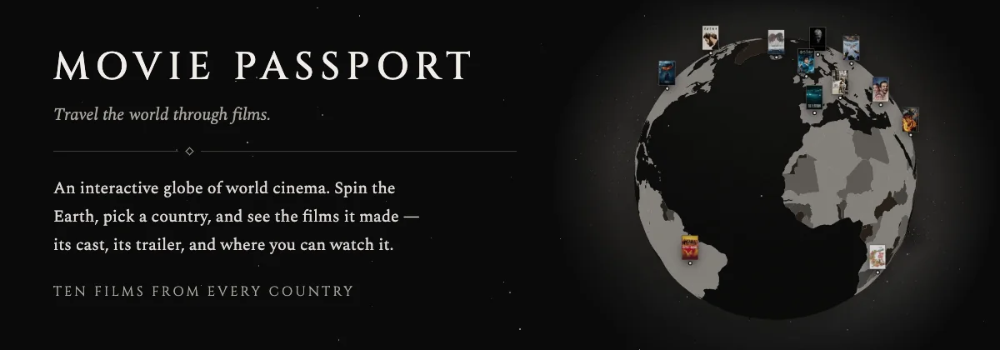

<p align="center">
  
</p>

<p align="center">
  <a href="https://movie-passport-eight.vercel.app/"><strong>Open the live globe</strong></a>
  &nbsp;·&nbsp; <a href="PRODUCT.md">What it is for</a>
  &nbsp;·&nbsp; <a href="DESIGN.md">The Velvet Night design system</a>
  &nbsp;·&nbsp; <a href="docs/decisions/">Decisions</a>
</p>

## The globe is the index

Film sites list countries as metadata. Here the country is the way in. Every film is pinned in the
country that made it and listed under everyone who co-produced it, and places a world map has no
shape for (Hong Kong, Malta) or that no longer exist (the Soviet Union, Yugoslavia) still get a
place of their own.

Silver countries have films — the brighter, the more. Click one and the camera flies to it.


## Using it

- **Drag** to rotate, **scroll / pinch** to zoom. The globe turns slowly when left alone.
- **Hover** a country for its name and film count; **click / tap** to fly to it. A country with no
  films suggests nearby ones that do.
- The panel separates the films **from** a country from the ones it **co-produced**, with counts
  and decades.
- **Click a poster** — or a film in the list — to open its card: the camera flies to it, every
  production country lights up, and the other posters dim. Posters are also reachable with **Tab**
  and **Enter**.
- Press **/** to search countries and films. It matches ISO codes (`jp`), original titles and
  directors as well as titles.
- With _reduce motion_ turned on in your OS, auto-rotation is off and camera moves are instant.


## Every view has a link

`?country=JP`, `?film=129`, `?film=129&details` — browser Back and Forward move between views, and
any view can be shared. The gauge on the left edge shows how deep you are, and the levels above it
are links back out; **Back to globe** or **Esc** steps out too.


## It ends at a film you can watch

**More details** opens the film's page over the globe: cast and crew, the trailer (loaded from
YouTube only when you press play), where to stream, rent or buy it in your region, facts, more
films from the same country, and similar films.


## Getting started

Requires Node 20.9+ (developed on 24). pnpm comes from corepack: run `corepack enable` once, or
prefix commands with `corepack`.

```bash
pnpm install
pnpm dev                 # http://127.0.0.1:3002
```

That is enough to spin the globe. Without TMDB data the app shows a hand-picked sample of 20 films
with generated poster art (`src/data/movies.ts`); see [Data](#data) to fetch the real catalogue.

`pnpm check` runs lint, typecheck, unit tests and the production build.

<details>
<summary>All commands</summary>

| Command               | What it does                                                              |
| --------------------- | ------------------------------------------------------------------------- |
| `pnpm dev`            | Dev server on http://127.0.0.1:3002 (loopback only)                       |
| `pnpm build`          | Production build                                                          |
| `pnpm start`          | Serves the production build on http://127.0.0.1:3002                      |
| `pnpm check`          | Lint, typecheck, unit tests and the production build                      |
| `pnpm test`           | Unit tests (Vitest): geometry, camera, posters, catalogue and search      |
| `pnpm test:e2e`       | Browser tests (Playwright): builds to `.next-e2e/` and serves it on :3202 |
| `pnpm format`         | Prettier with Tailwind class sorting (`format:check` to verify)           |
| `pnpm data:countries` | Rebuilds `public/data/countries-110m.geojson` from Natural Earth          |
| `pnpm data:catalogue` | Fetches the TMDB film catalogue into `public/data/` (needs `.env.local`)  |
| `pnpm data:places`    | Rebuilds `src/data/places.json` (small places and historical states)      |

The first `pnpm test:e2e` needs a Playwright browser: `pnpm exec playwright install chromium`.

</details>

## How it fits together

Next.js 16 (App Router), TypeScript, Tailwind CSS 4,
[react-globe.gl](https://github.com/vasturiano/react-globe.gl) and three.js.

```
src/components/globe/MovieGlobe.tsx       app state (world / country / film), overlays, Esc, URL
src/components/globe/GlobeScene.tsx       the only file that touches react-globe.gl / three.js
src/components/globe/nightSky.ts          the stars and Milky Way behind the globe
src/components/globe/plateTexture.ts      the globe's velvet surface
src/components/globe/CountryInfo.tsx      country panel; MovieInfo.tsx is the film card
src/components/globe/posters/             poster markers (HTML) and the sprite spike
src/components/details/FilmDetailsSheet   the film's page (cast, trailer, where to watch)
src/components/search/SearchBox.tsx       country and film search
src/components/ui/plate.ts                shared button, chip and panel styles
src/lib/geo/                              countries, small places, camera viewpoints
src/lib/globe/theme.ts                    globe colours, lift and timing
src/lib/movies/                           poster art, size, spacing and how many to show
src/lib/data/                             TMDB catalogue and film details parsing
src/data/movies.ts                        sample catalogue used without TMDB data
```

`GlobeScene` is loaded with `next/dynamic` and `ssr: false`: WebGL only exists in the browser.

Clicks are resolved from the pointer's release position (`toGlobeCoords` + point-in-polygon) rather
than react-globe.gl's `onPolygonClick`, which reports its last _throttled_ hover raycast and can
miss quick taps.

### Performance

The globe holds 60 fps with the CPU slowed 4×, with up to 60 posters on screen. Lighthouse on the
production build: desktop 97–99 and mobile 73–74 for performance, 100 for accessibility, best
practices and SEO. Measurements and what was fixed:
[`docs/decisions/0003-performance-pass.md`](docs/decisions/0003-performance-pass.md).

### Browser tests

`pnpm test:e2e` builds the app with `NEXT_PUBLIC_GLOBE_TEST_HOOK=1`, which exposes
`window.__moviePassportGlobe` so tests can aim at a country's exact screen position. The hook is
compiled out of normal builds. On macOS the tests use the GPU (Metal); elsewhere Chromium falls back
to software WebGL, which is slower.

## Data

Country boundaries: [Natural Earth](https://www.naturalearthdata.com/) 1:110m Admin 0 – Countries,
public domain.

Films come from [TMDB](https://www.themoviedb.org/) (non-commercial use, with attribution in the
app's About dialog). Where-to-watch data is TMDB's, provided by
[JustWatch](https://www.justwatch.com/) and credited in the details sheet. The data is **fetched at
build time and never committed** — TMDB's terms forbid redistributing it:

1. Get a free API Read Access Token at <https://www.themoviedb.org/settings/api>.
2. `cp .env.example .env.local` and set `TMDB_READ_TOKEN`. `.env.local` is gitignored; the token is
   only read by the fetch script and never reaches the browser.
3. `pnpm data:catalogue` — the 10 most-voted films from each country and small place (about 1,170
   films, spanning 1898 to now), plus one details file per film, written to `public/data/`
   (gitignored). Re-run monthly: TMDB allows caching for at most 6 months.

See [`docs/decisions/0002-movie-data-source.md`](docs/decisions/0002-movie-data-source.md) for why
TMDB, and why the sample catalogue exists.

This product uses the TMDB API but is not endorsed or certified by TMDB. The screenshots above show
TMDB artwork and metadata as the app displays it, with the same credit.

Typefaces: [Cinzel](https://fonts.google.com/specimen/Cinzel) and
[Spectral](https://fonts.google.com/specimen/Spectral) (SIL Open Font License), self-hosted at build
time. Icons: [Lucide](https://lucide.dev/) (ISC).

## Deploying

The live site runs on [Vercel](https://vercel.com/), built from `main`. Project settings:

- **Build Command:** `pnpm data:catalogue && pnpm build`, so every deploy fetches the catalogue
  from TMDB first (it is never committed).
- **Environment variables** (Production and Preview):
  - `TMDB_READ_TOKEN`, marked Sensitive. Only the build reads it; it never reaches the browser.
  - `ENABLE_EXPERIMENTAL_COREPACK=1`, so Vercel installs the pnpm version pinned in `package.json`.

Redeploy at least every 6 months (monthly is better) to refresh the data within TMDB's caching
limit.

## Debug panel

Add `?debug` to the URL for a frame-rate meter and the poster-rendering controls, e.g.
`/?debug&renderer=sprites&posters=1000&cap=0`. See
[`docs/decisions/0001-poster-rendering.md`](docs/decisions/0001-poster-rendering.md).

A non-commercial project.
